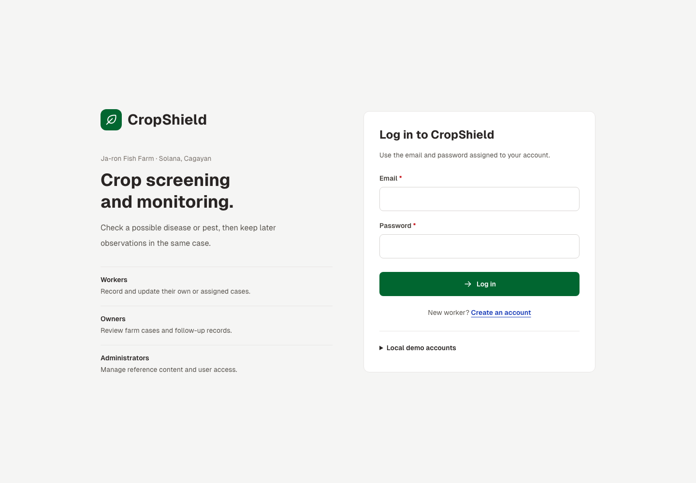
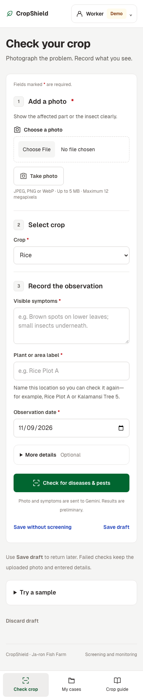
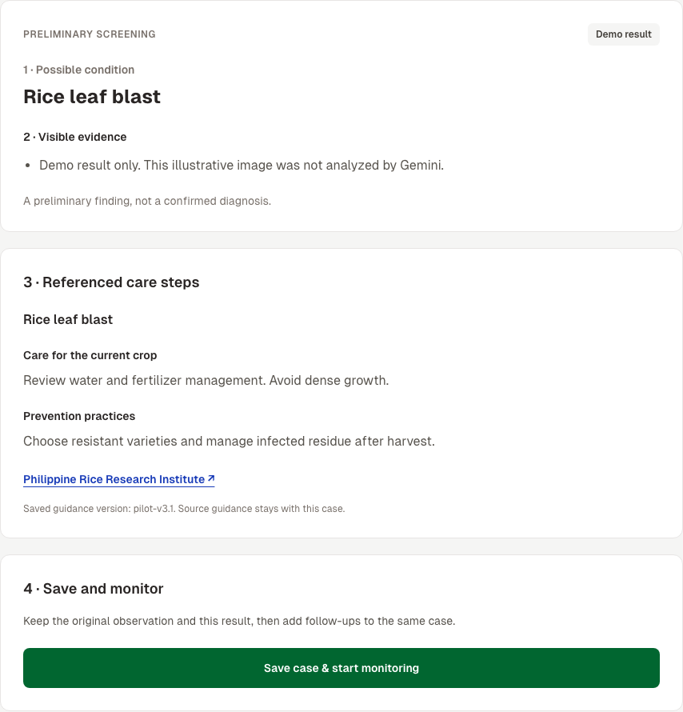
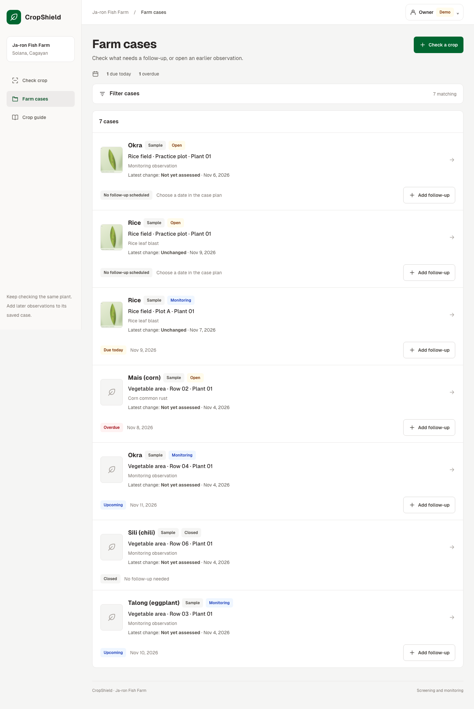
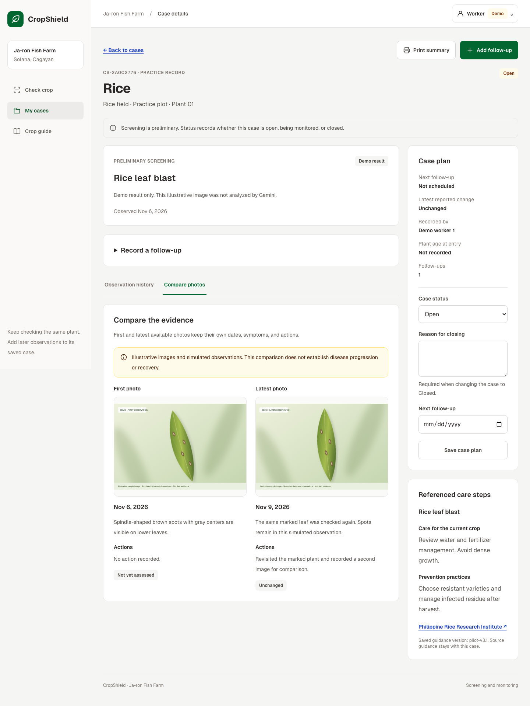
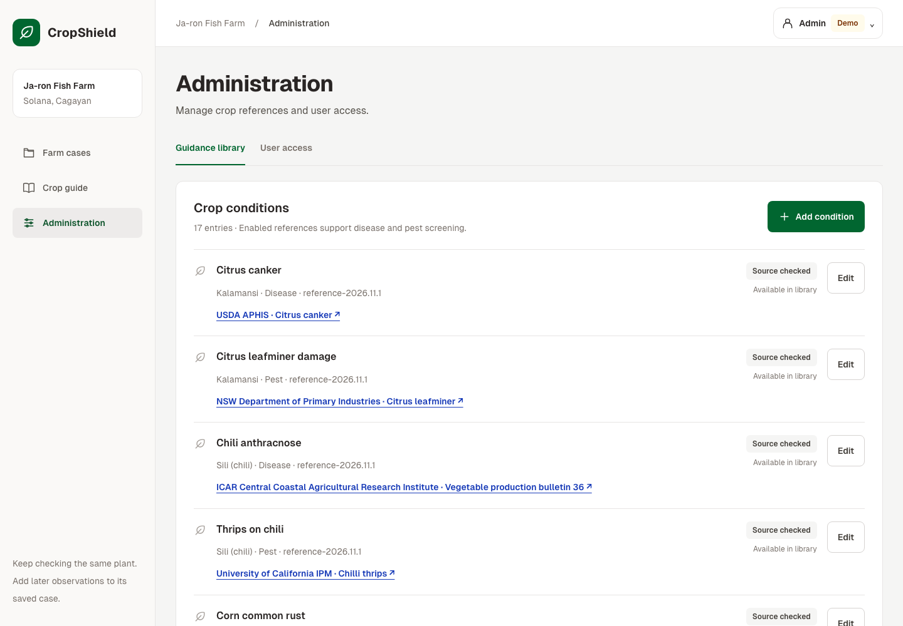

# CropShield: A Web-Based Crop Disease Screening and Monitoring System

CropShield helps the owners and workers of Ja-ron Fish Farm in Solana, Cagayan screen possible crop diseases and pests using photographs and visible symptoms. It links preliminary findings to referenced guidance and keeps dated observations for the same plant or crop area.

This is an early capstone prototype built with **Laravel 13, PHP, Blade components, Tailwind CSS, Vite, Eloquent, and MySQL**. The application now uses native Laravel routes, controllers, models, migrations, validation, and session authentication.

## Group members

- Yohann Tomas
- Aaron Pocot

## Roles

| Role | Landing page | Prototype access |
|---|---|---|
| Worker | `/worker` | Submit crop observations; screen photos; save and update own or assigned cases; add follow-ups and print summaries. |
| Owner | `/owner` | Review farm cases; assign workers; record follow-ups and update case plans. |
| Administrator | `/admin` | Create accounts, manage user access, and maintain the disease/pest guidance library. |

Public registration creates a **worker**. Only an authenticated administrator can create owner or admin accounts. Users log out through the account menu. Logged-out users are redirected to `/login`; visiting another role's landing page returns a 403 access page. Shared case routes also check record ownership and assignments on the server. There is no expert verification workflow.

## Core feature: screen, save, and monitor a crop case

1. A worker selects a crop and submits a photo, location label, observation date, and symptoms. Plant age and actions already taken are optional.
2. Laravel validates the submission on the server. Live image screening calls Gemini from PHP; the local sample workflow produces a clearly labeled **Demo result**.
3. A supported preliminary suggestion displays the enabled condition's management information, prevention practices, and source link. Unclear or unsupported findings receive no invented condition-specific advice.
4. The worker saves the case to MySQL. Its creator is the authenticated user, not a user ID supplied by the form.
5. The owner can review the saved case and add a later observation. Follow-ups append photos, symptoms, actions, and a reported change without replacing the original observation.
6. The case shows first/latest photos and a printable summary. Reported change is separate from case status: open, monitoring, or closed. Closing a case requires a reason.

**Save draft** stores unfinished fields and uploaded image references in MySQL. A completed result returns with its unchanged draft. A failed check retains the photo and details so the user can retry or save without screening.

## Setup from a fresh clone

Requirements: **PHP 8.4+**, Composer, MySQL, and **Node.js 20.19+ or 22.12+**. PHP needs the usual Laravel extensions plus GD, Fileinfo, PDO MySQL, and PDO SQLite for the automated test suite. MAMP's matching PHP/MySQL can be used; enter its actual connection settings in your private `.env`.

Create an empty MySQL database named `cropshield_laravel`, then run:

```bash
git clone https://github.com/yoshanbao/cropshield.git
cd cropshield
composer install
cp .env.example .env
php artisan key:generate
```

Edit `.env` with your own `DB_HOST`, `DB_PORT`, `DB_DATABASE`, `DB_USERNAME`, and `DB_PASSWORD`. A Gemini key is optional for the labeled sample demonstration; live screening needs `GEMINI_API_KEY`.

```bash
php artisan migrate --seed
npm ci
npm run build
php artisan serve --host=127.0.0.1 --port=8001
```

Open **http://127.0.0.1:8001/login**. `npm run build` supplies the compiled assets, so the class demo can run with only the Laravel server. While editing Tailwind classes, run `npm run dev` in a second terminal instead.

All application tables are created through files in `database/migrations/`. `DatabaseSeeder` creates the reference library, synthetic practice cases, and the demo accounts below. `vendor/`, `node_modules/`, compiled assets, and local secrets are excluded from Git.

### Clean-setup rehearsal

The assignment's `migrate:fresh --seed` demonstration must use a **separate demo database**. Set `DB_DATABASE` to that empty demo database in your local environment before running:

```bash
php artisan migrate:fresh --seed
npm run build
php artisan serve --host=127.0.0.1 --port=8001
```

`migrate:fresh` deletes tables in the selected database. The conversion and browser verification used separate databases; they did not reset the original CropShield database.

## Local demo accounts

These are intentionally public practice credentials. Demo login requires a loopback host, `APP_ENV=local` or `testing`, and `CROPSHIELD_LOCAL_DEMO=true`. It is blocked in production and on public hosts. Real accounts use their own passwords.

| Role | Email | Password |
|---|---|---|
| Worker | `worker-1@demo.cropshield.local` | `WorkerDemo123!` |
| Worker 2 | `worker-2@demo.cropshield.local` | `WorkerDemo123!` |
| Owner | `owner@demo.cropshield.local` | `OwnerDemo123!` |
| Admin | `admin@demo.cropshield.local` | `AdminDemo123!` |

Seeding resets only the four labeled demo accounts. It does not overwrite real-user passwords, existing crop cases, or edited guidance entries.

## Ten-minute demonstration

1. Introduce the farm, the crop screening/monitoring problem, and the three roles.
2. Log in as each seeded role, show its landing page, and log out between accounts.
3. While logged out, type `/owner`; show the login redirect. As a worker, type `/admin`; show the 403 page.
4. As a demo worker, open **Try a sample → Load rice example → Show demo result**. Explain that the result is preliminary and simulated.
5. Save the case, open **Add follow-up**, enter later symptoms/actions/change, and select the labeled later rice illustration. Save, compare the photos, and open **Print summary**.
6. Log in as owner to review the case and schedule a follow-up. Log in as admin to show **User access → Create user** and the referenced condition library.
7. Demonstrate validation with missing symptoms or a closing status without a reason. Show the field errors and retained details.
8. Start another sample and select **Temporary service error**. Submit, then use **Retry check**. Select **Unclear submission** to show the retake action. Use **Outside named demo coverage** with another crop to save an observation without unsupported guidance.
9. Walk through the files below. Each group member should be able to explain the relevant controller, middleware, model relationship, and Blade form.

## Coding style from the Blade components lesson

The interface uses anonymous components in `resources/views/components/`, matching the lesson's props, bound props, slots, attribute merging, `old()`, and field-level `@error` pattern. CSS and the small photo-preview helpers load through `@vite`.

```blade
<x-layout :title="$title">
    @forelse ($cases as $case)
        <x-case-card :case="$case" />
    @empty
        <p class="text-stone-500">No matching cases yet.</p>
    @endforelse
</x-layout>
```

- `layout.blade.php`: `@props`, the shared page shell, `{{ $slot }}`, navigation, flash alerts, and Vite assets.
- `input-field.blade.php`: label, input/textarea, `old($name, $value)`, help text, `$attributes->merge()`, and `@error($name)`.
- `select-field.blade.php`, `button.blade.php`, `alert.blade.php`, `case-card.blade.php`, and `guidance.blade.php`: reusable interface pieces.
- Mutations use named routes and POST forms with `@csrf`. Editing forms include `@method('PATCH')` or `@method('PUT')`; draft deletion uses `@method('DELETE')`.

| Code to explain | File |
|---|---|
| Named routes and role groups | `routes/web.php` |
| Login, registration, password checks, session regeneration/logout | `app/Http/Controllers/AuthController.php` |
| Role and current-account checks | `app/Http/Middleware/EnsureRole.php`, `EnsureActive.php` |
| Record visibility and update permissions | `app/Policies/CropCasePolicy.php`, `app/Models/CropCase.php` |
| Validate and save the core crop case | `app/Http/Controllers/CaseController.php` |
| Dated follow-up validation and saving | `app/Http/Controllers/ObservationController.php` |
| Draft/result retention and server-only screening | `app/Services/DraftService.php`, `ScreeningService.php` |
| Schema and demo data | `database/migrations/`, `database/seeders/DatabaseSeeder.php` |
| List and create screens | `resources/views/cases/index.blade.php`, `create.blade.php` |

## Website screenshots

These show the **Laravel/Blade version**. They were captured using an isolated MySQL database containing only synthetic accounts and practice records. The leaf images are labeled illustrations, and the screening shown is simulated.

### 1. Login



Email/password login opens the appropriate role workspace. Worker registration is available here; owner and admin creation is restricted to an authenticated administrator.

### 2. Mobile crop entry



The phone form keeps clear labels and location help. Optional details are collapsed, and the navigation exposes the main tasks.

### 3. Preliminary result



The result follows **Possible condition → Visible evidence → Referenced care steps → Save and monitor**. It is not a confirmed diagnosis.

### 4. Owner's farm cases



Owners review cases with thumbnails, the latest reported change, and follow-up reminders. The records shown are synthetic.

### 5. Compare and monitor



The worker saved a case and follow-up to MySQL before capture. Dates, symptoms, actions, and reported change stay attached to each observation. **Print summary** opens the complete printable record.

### 6. Administration



Administrators maintain reference content and user access. Content review status does not mean an expert verified a crop case.

## Crop coverage and screening

Recording and monitoring support **mais, kalamansi, okra, talong, sili, kamote, suha, and rice**. The starter library contains 17 source-linked entries: 9 diseases and 8 pests. It includes rice leaf blast, rice bacterial leaf blight, and corn common rust, plus the later source-linked crop/pest additions.

Live Gemini requests run entirely in PHP and use the actual private uploaded photo and symptoms. Output is validated against enabled condition IDs for the selected crop. The model cannot supply management advice; that comes from the matched database entry. Unclear, normal-looking, unsupported, mismatched, and non-plant submissions receive no invented condition-specific guidance. A configured free API can still encounter quota or service limits; drafts remain available for retry or monitoring.

Sources and limitations are stored in `database/data/conditions.json` and in the database. They include PhilRice, CABI, government agriculture departments, university extension services, and the World Vegetable Center. The team must evaluate screening accuracy using suitable field data; the prototype tests and illustrations do not establish diagnostic accuracy or treatment effectiveness.

## Existing-project migration

Laravel now replaces the previous Next.js application at the project root. The local conversion uses `cropshield_laravel`, leaving the previous database unchanged. Current accounts, monitoring cases, observations, private photo bytes, assignments, guidance, and drafts were imported. Existing real-user bcrypt digests were preserved with PHP-compatible prefixes. Earlier FARMER/EXPERT roles import as workers; owner/admin roles retain their corresponding access. Old verification tables remain only in the original database.

For a separate installation that already has the old database, set the private `LEGACY_DATABASE_URL`, run Laravel migrations, then:

```bash
php artisan cropshield:import-nextjs --dry-run
php artisan cropshield:import-nextjs
php artisan db:seed
```

The import refuses to use the same source and target database. It copies records without modifying the source and does not overwrite existing target records. It is optional; fresh-clone demonstrations need only migrations and seeding. Local source/settings backups are ignored by Git, and the previous public version remains in Git history.

## Security and public repository

Passwords are hashed; session IDs regenerate at login; logout invalidates the session and regenerates the CSRF token. Laravel's CSRF middleware remains enabled. Server middleware rechecks active access, policies scope records, and private image routes check authorization. Uploads accept bounded JPEG/PNG/WebP images; new photos are resized and re-encoded before private storage.

Photos live in `storage/app/private/`, outside the public document root. The repository contains no real user records, uploaded farm photos, local environment files, database exports, API keys, application keys, or session payloads. `.env.example` contains placeholders, and screenshots contain only isolated demo data. GitHub secret scanning and push protection are enabled.

Use `public/` as the web server document root. Public hosting requires `APP_ENV=production`, `APP_DEBUG=false`, HTTPS, secure session cookies, and private deployment credentials. The published demo accounts are not available in production.

## Verification

```bash
php artisan test
vendor/bin/pint --test
composer validate
npm run build
```

Feature tests cover authentication, least-privilege registration, role and record access, private images, real photo/case persistence, immutable guidance, draft/result recovery, chronology, closure reasons, assignments, admin account creation, sourced guidance validation, and bounded server-side screening behavior. The browser walkthrough also exercised real CSRF enforcement, MySQL writes, role landings/logout, comparison, printing, retry, and phone/desktop widths. Fresh MySQL migrations and seeding were rehearsed in isolated databases, which were removed afterward.

Public repository: [yoshanbao/cropshield](https://github.com/yoshanbao/cropshield).
